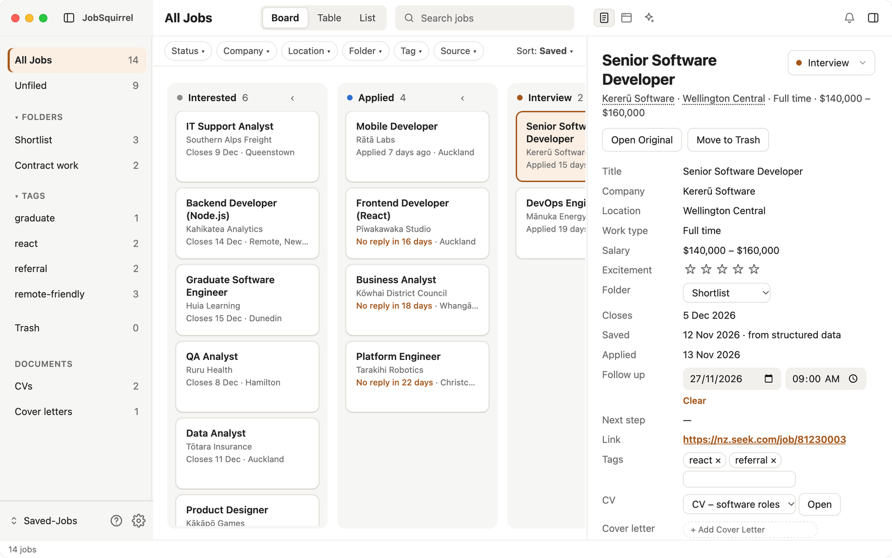
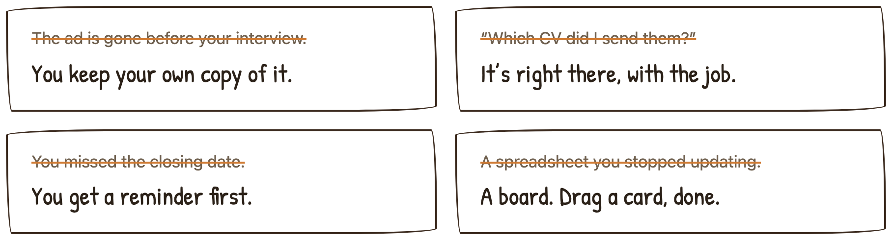

  
  <h1>Your personal all-in-one job hunting dashboard</h1>
  
Save any job ad with one click. Then see every application, deadline, interview and CV on one screen.

  

    <a href="https://github.com/foxnz/landfern/releases/download/v0.1.2/JobSquirrel-0.1.2-universal.dmg"><strong>Download for Mac</strong></a> ·
    <a href="https://github.com/foxnz/landfern/releases/download/v0.1.2/JobSquirrel-Setup-0.1.2.exe"><strong>Download for Windows</strong></a> ·
    <a href="https://github.com/foxnz/landfern/releases/download/v0.1.2/jobsquirrel-extension-0.1.2.zip"><strong>Chrome extension</strong></a>
  

  

    <a href="https://jobsquirrel.nz">Website</a> ·
    <a href="https://jobsquirrel.nz/help.html">Help</a> ·
    <a href="https://jobsquirrel.nz/contact.html">Send feedback</a>
  

  
Add the extension to Chrome with one drag. <a href="https://jobsquirrel.nz/#extension">How</a>

  
macOS 14 or later · Windows 10 or 11: if it warns you, click More info → Run anyway

  

 

### Sound familiar?

<picture>
  <source media="(prefers-color-scheme: dark)" srcset="assets/familiar-dark.png">
  
</picture>

### See a job. Click. Done.

Works with Seek, LinkedIn, Indeed, Trade Me Jobs, SEEK Grad, Prosple, Student Job Search and any other job page. Free, no account: your jobs stay in a folder on your computer.

⭐ If it helps your search, a star helps other job seekers find it.

JobSquirrel is in beta. This page is for downloads; the app is not open source. Made-up jobs in the pictures.
