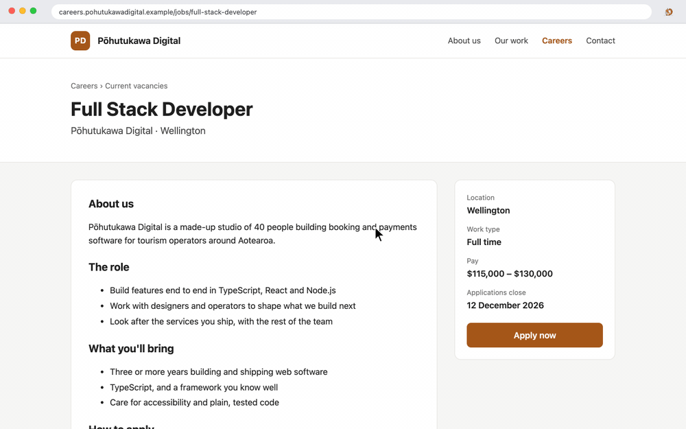
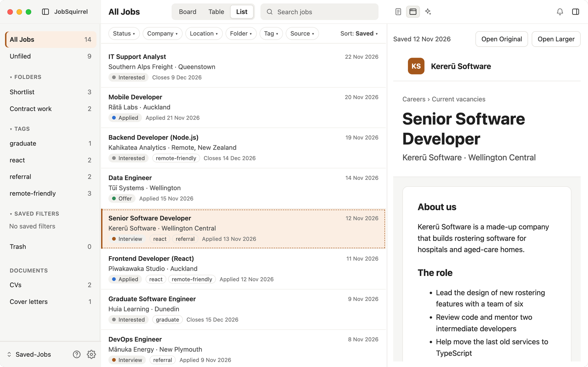
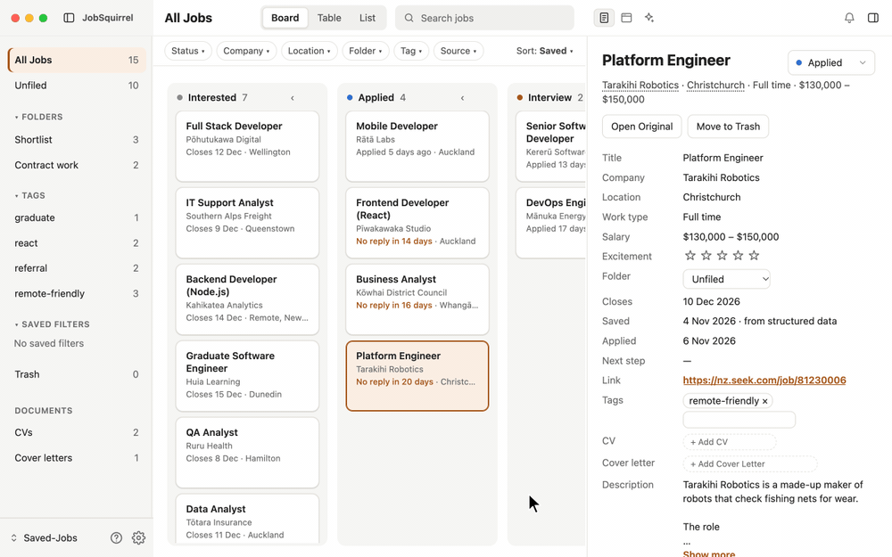
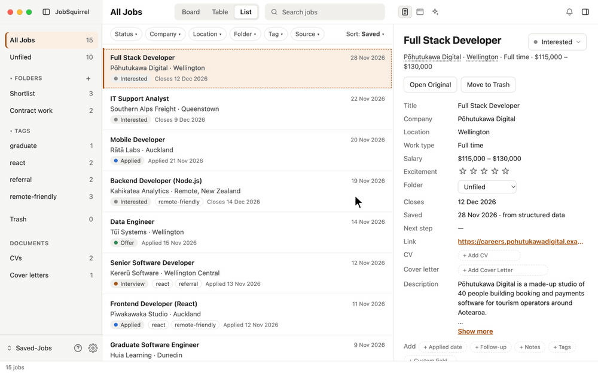
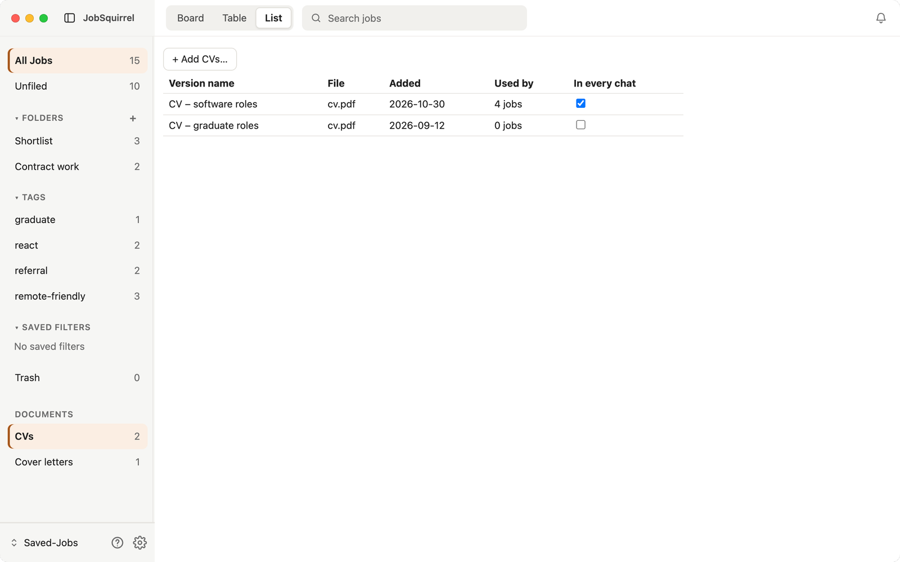
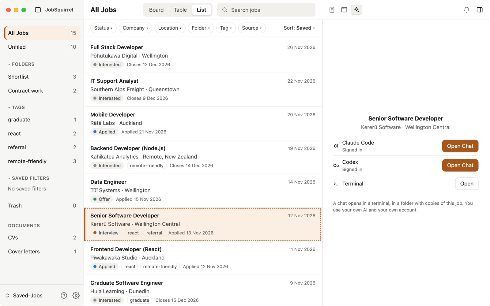
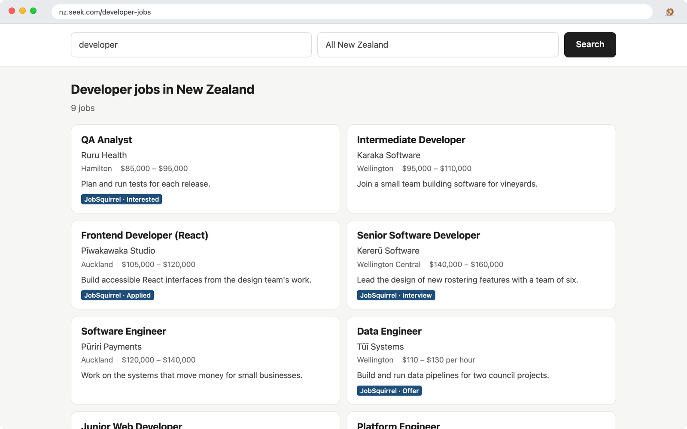

  
  <h1>Your personal all-in-one job hunting dashboard</h1>
  
Save any job ad with one click. Then see every application, deadline, interview and CV on one screen.

  

    <a href="https://github.com/foxnz/landfern/releases/latest/download/JobSquirrel.dmg"><strong>Download for Mac</strong></a> ·
    <a href="https://github.com/foxnz/landfern/releases/latest/download/JobSquirrel-Setup.exe"><strong>Download for Windows</strong></a> ·
    <a href="https://github.com/foxnz/landfern/releases/latest/download/JobSquirrel-Chrome-extension.zip"><strong>Chrome extension</strong></a>
  

  

    <a href="https://jobsquirrel.nz">Website</a> ·
    <a href="https://jobsquirrel.nz/help.html">Help</a> ·
    <a href="https://jobsquirrel.nz/contact.html">Send feedback</a>
  

  
Download the app and the extension, then drag the extension into Chrome. <a href="https://jobsquirrel.nz/#extension">How</a>

  
macOS 14 or later · Windows 10 or 11: if it warns you, click More info → Run anyway

  

 

### Sound familiar?

<picture>
  <source media="(prefers-color-scheme: dark)" srcset="assets/familiar-dark.png">
  
</picture>

### See a job. Click. Done.

Click the squirrel on a job ad. JobSquirrel fills in the title, company, pay, location and closing date, and keeps a full copy of the ad. Works with Seek, LinkedIn, Indeed, Trade Me Jobs, SEEK Grad, Prosple, Student Job Search and any other job page.

### Your own copy of every ad

Ads come down when the job closes, often just before your interview. Your copy stays, as the ad looked, and opens without the internet.

### Every application at a glance

Drag a card from Applied to Interview. Board, Table or List; status, applied date, follow-up, next step, interview notes and fields of your own.

### Find any job in seconds

Search by title, company, place, tag or folder, then narrow it down by status, location or site. Keep the filters you use often.

### Know which CV you sent

Keep each version of your CV and cover letter, PDF or Word, and link it to the jobs you sent it with.

### Chat about a job with the AI you already use

Right-click a job ▸ **Chat About This Job**. Claude Code or Codex opens inside JobSquirrel, signed in as you, with a copy of the ad, your notes and your CV. Ask for a cover letter or interview questions, then use what it writes as the job's cover letter in one click. JobSquirrel sells no AI and sends nothing itself.

### See what you've already saved

On Seek's search results, the jobs you saved carry a label with their status. Turn it on in the extension's settings.

### Also in the box

Reminders before closing dates and follow-ups · folders, tags and saved filters · several libraries · **Export Backup…** to one zip · a Trash you can restore from · one-click updates · light and dark · keyboard shortcuts.

**Yours, and only yours.** Your jobs are plain files in a folder on your computer. No account, no tracking, nothing sent by default.

⭐ If it helps your search, a star helps other job seekers find it.

JobSquirrel is in beta. This page is for downloads; the app is not open source. Made-up jobs in the pictures.
